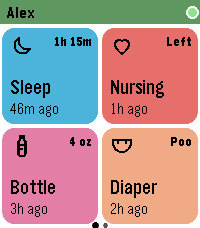
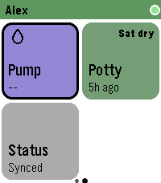
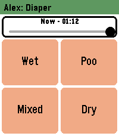
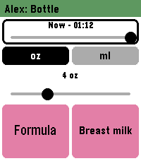
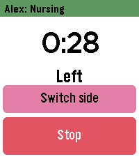

# nappi-pebble

Log your baby's feeds, diapers, potty, sleep and pumping to [nappi](https://nappi.app) from a Pebble Time 2. Open the app, tap a big colour tile, done: most things take two taps.

It is a C watch app (Emery, touch) plus PebbleKit JS on the phone, which holds your API token and talks to `api.nappi.app`. Entries queue on the phone when it is offline and send when it reconnects.

<p>
  
  
  
  
  
</p>

Home grid, second page, Diaper, Bottle and the nursing timer, from the Emery emulator against the mock API (`docs/screenshots/`). The emulator has no touch, so the focus ring you see on some screens is the button fallback.

**You need** a Pebble Time 2, the Pebble phone app, a nappi account with Premium, and an API token from nappi (see [nappi's API docs](https://nappi.app/app/api/reference)). Paste the token into nappi-pebble's settings in the phone app, then pick your baby.

## Documentation

| Doc | What it covers |
|---|---|
| [docs/PRODUCT.md](docs/PRODUCT.md) | Every feature and its limits |
| [docs/ARCHITECTURE.md](docs/ARCHITECTURE.md) | How it is built, the decisions behind it, rules for changing it, known limitations |
| [docs/store-listing.md](docs/store-listing.md) | Appstore fields, description, assets, publish checklist |
| [AGENTS.md](AGENTS.md) | Start here if you are changing the code (human or agent) |

## Develop

```sh
npm ci
npm test                           # JS tests then host-side C tests; no Pebble tooling needed
pebble clean && pebble build       # emery .pbw (SDK 4.33.1)
SEED=1 TWO_BABIES=1 npm run mock   # fake nappi API on http://127.0.0.1:4010
pebble install --emulator emery
```

Mock tokens: `dev-token` (good), `expired-token`, `revoked-token`, `free-token` (no Premium). Set the settings page's API address to `http://localhost:4010`. More commands, the emulator workflow and the gotchas are in [AGENTS.md](AGENTS.md).

## License

MIT, see `LICENSE`. The tile icons in `art/icons/` and the logo in `art/nappi-logo.png` (with the menu and store icons built from it) are nappi's artwork, not ours, and the MIT license does not cover them. The screenshots in `docs/screenshots/` show those icons, so the same applies to them.
